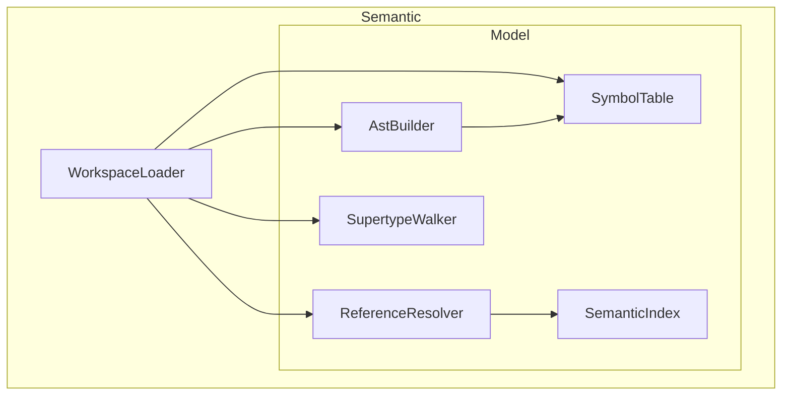

## DemaConsulting.SysML2Tools — Semantic Subsystem

### Overview

The Semantic subsystem builds a semantic workspace from the parsed SysML/KerML source files. It
operates as a second layer above the Parser subsystem, consuming ANTLR4 CSTs produced by
`WorkspaceParser` and transforming them into a structured symbol table with resolved references.

### Interfaces

The Semantic subsystem contains one public unit (`WorkspaceLoader`) and a Model subsystem
(`Model`) containing `AstBuilder`, `SymbolTable`, `ReferenceResolver`, `SupertypeWalker`,
`SysmlEdge`, `SemanticIndex`, and `SysmlAnnotation`.

**WorkspaceLoader.LoadAsync**: Loads every file in the provided collection asynchronously,
optionally seeded with a pre-populated symbol table.

- *Type*: In-process .NET static async method.
- *Role*: Provider.
- *Contract*: Accepts `IEnumerable<string> filePaths`, an optional `SymbolTable? seedSymbolTable`, and
  an optional `bool strictUnresolved` (default `false`);
  returns `Task<SysmlLoadResult>` containing a `SysmlWorkspace` with all qualified-name declarations
  and all collected diagnostics. When `seedSymbolTable` is provided, the workspace is initialized with
  a copy of its symbols before processing user files. User files are parsed in parallel on the
  thread pool. Unresolved references in the user files are reported as Warning diagnostics by
  default, or as Errors when `strictUnresolved` is `true`.
- *Constraints*: `filePaths` must not be null; each path should be a readable file path.

**SysmlLoadResult**: Aggregate result returned by `WorkspaceLoader.LoadAsync`.

- *Type*: Sealed record.
- *Role*: Data transfer object.
- *Contract*: Exposes `SysmlWorkspace? Workspace`, `IReadOnlyList<SysmlDiagnostic> Diagnostics`,
  and `bool HasErrors`.
  Callers choose the unresolved-reference severity (see `WorkspaceLoader.LoadAsync`).

**SysmlWorkspace**: Fully-loaded and semantically-resolved workspace.

- *Type*: Sealed class.
- *Role*: Data container.
- *Contract*: Exposes `IReadOnlyList<string> Files`, `IReadOnlySet<string> StdlibNames` (exactly the
  qualified names of the seed symbol table — the origin-based record of which declarations are
  standard library, never derived from element names),
  `IReadOnlyDictionary<string, SysmlNode> Declarations` mapping qualified names to declaration
  nodes, and `SemanticIndex Index` — a reverse-lookup index over all resolved edge kinds
  (supertype, typing, redefinition, import, satisfy, verify, allocate, connect, transition, and
  expose; see Semantic Model Subsystem).

### Design

1. `WorkspaceLoader.LoadAsync` creates a `SymbolTable` seeded from `seedSymbolTable` via the copy
   constructor `new SymbolTable(seedSymbolTable.Symbols)` when a seed is provided, or creates an
   empty `SymbolTable` when `seedSymbolTable` is `null`.
2. All caller-supplied file paths are dispatched via `Task.WhenAll`, each parsing
   its content via `WorkspaceParser.ParseSourceToCst`, building an AST — capturing any
   `comment`/`doc` annotating-element text onto each owning node's `Annotations` as it goes —
   and registering into the same `SymbolTable`.
3. `ReferenceResolver.ResolveAll` traverses all AST nodes, resolves each supertype, feature-typing,
   and import reference by KerML 8.2.3.5 name resolution (`NameResolver`: member visibility,
   filtered imports, import scoping), and emits a diagnostic for each unresolved
   reference — a Warning by default, an Error when `strictUnresolved` is set (a view `render` target
   naming a SysML2Tools extension selector gets a portability Warning instead). It also builds an
   import graph and performs cycle detection (Warning), and returns a
   `SemanticIndex` over all resolved edges.
4. `SupertypeWalker.WalkAll` traverses specialization chains for all symbols and emits Warning
   diagnostics for cyclic specialization.
5. A `SysmlWorkspace` is constructed from the loaded file list, symbol table, and the
   `SemanticIndex` returned by `ResolveAll`, and returned in a `SysmlLoadResult`.

### Design Constraints

- There is no shared static state; each call to `LoadAsync` creates an independent `SymbolTable`.
- `AstBuilder` is not thread-safe — a separate instance is created for each file.
