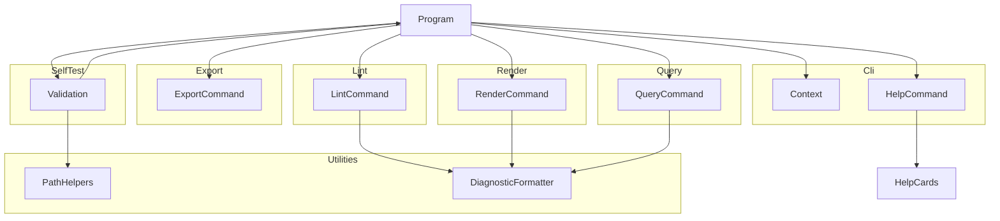

# DemaConsulting.SysML2Tools.Tool

## Architecture

The `DemaConsulting.SysML2Tools.Tool` is a command-line application built on .NET. It is structured as one
system containing one top-level unit (`Program`) and seven subsystems (`Cli`, `Lint`, `Render`,
`Query`, `Export`, `SelfTest`, `Utilities`):

`Program` is the entry point. It first offers the arguments to `HelpCommand` in the `Cli`
subsystem, which answers the `help` command from the built-in help cards (served by the
HelpCards OTS library); otherwise it creates a `Context` from the `Cli` subsystem, dispatches to
`LintCommand` when the `lint` subcommand is passed, dispatches to `RenderCommand` when the
`render` subcommand is passed, dispatches to `QueryCommand` when the `query` subcommand is passed,
dispatches to `ExportCommand` when the `export` subcommand is passed, dispatches to
`Validation` when `--validate` is passed, and returns the exit code from
`Context`. `Validation` calls `Program.Run` recursively to exercise the tool during
self-testing, and uses `PathHelpers` to construct safe temporary file paths. `LintCommand`,
`RenderCommand`, and `QueryCommand` format every diagnostic they print with
`DiagnosticFormatter`, so all three report diagnostics identically.

## External Interfaces

**Command-Line Interface**: The primary input interface for tool invocation.

- *Type*: CLI.
- *Role*: Consumer (the host environment invokes the system with command-line arguments).
- *Contract*: Accepts the `help` command as the first argument (see Help Command below), or the arguments
  `-v`/`--version`, `-?`/`-h`/`--help`, `--silent`, `--validate`, `--results <file>`, `--result <file>` (legacy alias
  for `--results`), `--depth <n>` (Markdown heading depth, shared by `--validate` and `query`), `--heading <text>`
  (Markdown heading text override, shared by `query`), and `--log <file>`. Accepts
  `lint [--strict-unresolved] <patterns...>` as a subcommand that invokes lint mode. Accepts
  `render [options] <patterns...>` (`--walk-depth <n>` controls diagram-nesting depth; `--strict-unresolved`) as a
  subcommand that renders diagrams. Accepts `<subcommand> --help`, which prints the short usage of that subcommand.
  Accepts `query <verb> [options] <patterns...>` (12 verbs; `--element`/`-e`, `--format`, `--direction`, `--kind`,
  `--name`, `--include-stdlib`, `--walk-depth` (bounded-traversal depth, meaningful only for the `impact` verb, applied
  uniformly to every relationship kind and unlimited when omitted), `--strict-unresolved` options). Accepts
  `export [options] <patterns...>` (`--format json|jsonl`, `--output <file>`, `--include-stdlib`, `--strict-unresolved`
  options) which dumps the resolved semantic model (declarations, edges, diagnostics) as JSON or JSON Lines. Returns
  exit code 0 for success and 1 for failures.
- *Constraints*: Unknown arguments cause exit code 1 and an error message on stderr.
  `--strict-unresolved` is accepted by `lint`, `render`, `query`, and `export`: unresolved
  references (a Warning diagnostic by default) become errors. Because load errors are written
  through `Context.WriteError`, `lint`, `render`, and `query` exit 1 for a model with unresolved
  references only when the flag is given — `render` and `query` still report the errors, continue,
  and produce their output. `export` prints no load diagnostics and keeps exit code 0; it reports
  them only in the JSON `Diagnostics` (`Severity` Warning by default, Error with the flag).

**Help Command**: Built-in help, answered from help cards embedded in the tool assembly.

- *Type*: CLI.
- *Role*: Provider.
- *Contract*: `sysml2tools help` prints the topic index and `sysml2tools help <topic>` prints a
  topic card with its examples. `sysml2tools help <command>` (the same as
  `sysml2tools help commands <command>`) prints the card of a subcommand, and
  `sysml2tools help query <verb>` the card of a query verb. HelpCards adds `--example`,
  `--search`, and `--json`. Returns exit code 0 for success, 2 for a wrong help argument or an
  unknown topic, and 70 for a defective card catalog.
- *Constraints*: `help` must be the first argument. It is answered before the options are parsed,
  so `--silent` and `--log` do not apply and no banner is printed.

**Standard Output**: Normal program output written to `Console.Out`.

- *Type*: Standard I/O.
- *Role*: Provider.
- *Contract*: Writes version, banner, help text, validation summary, or demo message depending
  on the flags provided. Suppressed when `--silent` is active; the log file still receives all
  output.
- *Constraints*: Human-readable text; no machine-parseable format contract.

**Standard Error**: Error message output written to `Console.Error`.

- *Type*: Standard I/O.
- *Role*: Provider.
- *Contract*: Writes error messages in red when a failure occurs. Suppressed when `--silent`
  is active but the exit code is still set to 1.
- *Constraints*: Color output requires a terminal that supports `ConsoleColor`.

**Log File**: Optional persistent output file.

- *Type*: File.
- *Role*: Provider.
- *Contract*: When `--log <file>` is supplied, all `Context.WriteLine` and `Context.WriteError`
  output is written to the file regardless of `--silent`. The file is truncated at open.
- *Constraints*: The path must be writable; failure to open the file raises an
  `InvalidOperationException` and causes exit code 1.

**Results File**: Optional self-validation results file.

- *Type*: File.
- *Role*: Provider.
- *Contract*: When `--results <file>` is supplied alongside `--validate`, self-validation results
  are serialized to the file. Extension `.trx` selects MSTest TRX format; `.xml` selects JUnit
  XML format.
- *Constraints*: Any other extension causes an error message and exit code 1; no file is written.

## Dependencies

- **DemaConsulting.SysML2Tools**: provides `WorkspaceParser`, `WorkspaceParseResult`, and
  `SysmlDiagnostic` for SysML v2 parsing in the Lint subsystem.
- **DemaConsulting.TestResults**: provides `TestResults`, `TestResult`, and `TestOutcome` for
  accumulating self-validation results.
- **DemaConsulting.TestResults.IO**: provides `TrxSerializer` and `JUnitSerializer` for writing
  results files.
- **DemaConsulting.HelpCards**: loads, validates, and serves the built-in help cards for the
  `help` command (see *HelpCards*, the OTS integration design).

## Risk Control Measures

N/A - not a safety-classified software item.

## Data Flow

1. The host environment starts the tool process and passes command-line arguments to
   `Program.Main`.
2. `Program.Main` offers the arguments to `HelpCommand.TryRun`. When the first argument is
   `help`, the help command builds the card catalog, writes its answer to the console, and
   `Program.Main` returns its exit code. Any other first argument returns at once without
   building the catalog.
3. `Program.Main` calls `Context.Create(args)`, which parses the arguments and opens the log
   file if `--log` was specified. An `ArgumentException` or `InvalidOperationException` at
   this point is caught, written to stderr, and causes exit code 1.
4. `Program.Run(context)` inspects the parsed flags and dispatches to one handler:
   - `--version` flag → `context.WriteLine(Version)`, then return.
   - Otherwise, `PrintBanner` is called first; then:
     - `--help` flag → `PrintTopLevelHelp(context)`, which ends with the pointer to the help
       command, or the short usage of the selected subcommand; then return.
     - `lint` subcommand → `LintCommand.Run(context)`.
     - `--validate` flag → `Validation.Run(context)`.
     - No flags → `RunToolLogic(context)`.
5. `Program.Main` returns `context.ExitCode` (0 if no errors were reported, 1 otherwise).

## Design Constraints

- Platform: targets net10.0 framework compatibility specifications on Windows, Linux, and macOS.
- Threading: single-threaded console application; no shared mutable state between invocations.
- Immutability: `Context` properties are set once at construction via `init` accessors and are
  read-only thereafter.
- Resource lifecycle: `Context` implements `IDisposable`; callers must dispose it to flush and
  close any open log file handle.
- Path safety: all caller-supplied path components are validated by `PathHelpers.SafePathCombine`
  before file-system use.
- Localization: `Program`, `Lint`, `Render`, `Query`, and `Export`'s banner/help text
  (everything printed by
  `PrintBanner`/`PrintTopLevelHelp`/`PrintHelp`/`PrintGeneralHelp`/`PrintVerbHelp`) is
  sourced from per-subsystem `.resx` files via hand-written `ResourceManager` accessor classes
  (`ProgramStrings`, `LintStrings`, `RenderStrings`, `QueryStrings`, `ExportStrings`), so a
  future non-English
  locale can be added with zero code changes (see
  `docs/design/sysml2-tools-tool/program.md`). Operational/diagnostic messages (progress
  lines, error messages) remain plain string literals and are explicitly out of scope for
  this localization mechanism.
