# SysML2Tools Diagram Gallery

This gallery showcases every diagram view type that SysML2Tools can render, each
generated from an interesting example system. Every model is rendered to both
**PNG** (raster, in [`png/`](png/)) and **SVG** (vector, in [`svg/`](svg/)).

All diagrams are produced by the `sysml2tools render` command directly from the
SysML v2 textual models in [`models/`](models/) — no manual layout. Where a
model declares an explicit `render asTreeDiagram;` or `render
asInterconnectionDiagram;` statement (the two rendering kinds SysML2Tools
currently implements), that takes precedence; otherwise the view kind is
inferred from each view's name (see the
[DiagramTypeRouter design](../design/sysml2-tools-core/rendering/internal/diagram-type-router.md)
for the full dispatch rules).

Every diagram uses the same plain, spec-style notation: white boxes with black one-pixel
borders and lines (the `SysmlThemes.Plain` theme), with meaning carried by shape, border and
line style, and text rather than by fill color.

To regenerate the gallery, run for each model:

```pwsh
sysml2tools render <model>.sysml --format png --output docs/gallery/png
sysml2tools render <model>.sysml --format svg --output docs/gallery/svg
```

---

## 1. General View — Quadcopter Drone

Shows every definition kind (part, port, interface, attribute, enumeration,
requirement) grouped in a package folder, with typed compartments (attributes,
ports, parts) and specialization edges. Definitions are placed by a layered
(ELK-style) engine with orthogonal edge routing.

`RacingMotor` also redefines `Motor`'s inherited `maxThrust` attribute
(`attribute :>> maxThrust : Mass;`), demonstrating the hollow-triangle-crossbar
marker used for `redefines`/`:>>` relationships.

`Drone`'s `connect controller.power to battery.output;` statement demonstrates
the plain, unmarked solid line used for `connect` between two sibling parts'
ports. `RacingDrone`'s `part frontMotors : Motor[2] subsets motors;` narrows
`Drone`'s inherited `motors` feature, demonstrating the dashed hollow-triangle
marker used for `subsets`/`:>` feature subsetting. `allocate FlightTimeRequirement
to Battery;` demonstrates the solid open-chevron line carrying the
`«allocate»` stereotype label used for allocation relationships, while the
standalone `dependency FlightController to Battery;` statement demonstrates the
dashed open-chevron line without a label, used for general OMG
dependency relationships.

`Battery`'s `comment /* ... */` annotation demonstrates the `BoxShape.Note`
(folded-corner) box rendered for a commented element, connected to its box by
a dashed line with no arrowhead, and its `doc /* ... */` documentation is drawn as a
word-wrapped `doc` compartment inside the `Battery` box. `FlightMode` is now an
`enum def` with literal values
(`idle`/`manual`/`autonomous`), demonstrating the `enums` compartment.
`FlightTimeRequirement` gains a `subject`/`require constraint` body,
demonstrating the stereotype-titled `«subject»`/`«require constraint»`
compartments (a constraint compartment shows its raw expression text rather
than a `name : Type` row). A definition that specializes another shows the
specialization in its name line (`RacingDrone :> Drone`), and a definition's short name
(`<shortName>`) would be shown ahead of its name.

Model: [`models/01-drone-general.sysml`](models/01-drone-general.sysml) ·
SVG: [`svg/DroneGeneralView.svg`](svg/DroneGeneralView.svg)

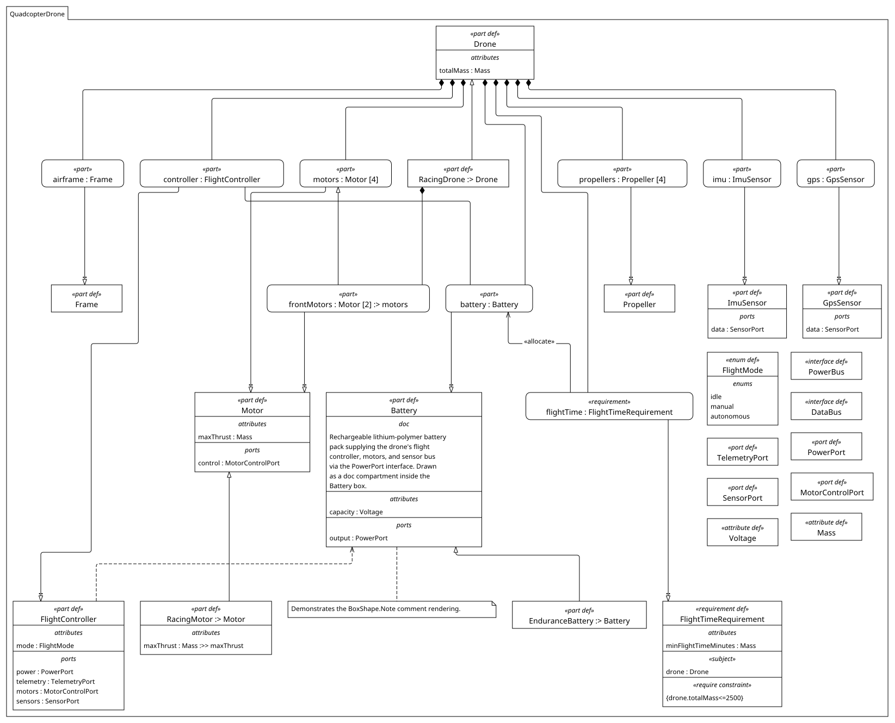

### 1b. View-scoped rendering — `expose` narrows the same model to one subsystem

The same `01-drone-general.sysml` model also declares a second, named `view` usage
that adds an `expose Battery::**;` statement. Instead of the full workspace, the diagram
is scoped to the `Battery` definition and its members — with no wrapping `QuadcopterDrone`
folder, since the package `QuadcopterDrone` was never itself exposed — demonstrating that
`expose` (not `render`) is what controls diagram content scope. The view also declares the
view condition `filter not @SysML::Documentation;`, so `Battery`'s documentation is not drawn
while its comment note still is. See the user
guide's [Expose vs. Render](../user_guide/introduction.md#expose-vs-render-worked-examples)
section for the full explanation and more worked examples.

Model: [`models/01-drone-general.sysml`](models/01-drone-general.sysml) (`BatterySubsystemView`) ·
SVG: [`svg/BatterySubsystemView.svg`](svg/BatterySubsystemView.svg)

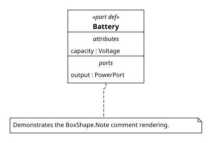

---

## 2. Interconnection View — Desktop Workstation

Shows the internal structure of a part: nested part usages placed by the
interconnection layout engine (a façade over the layered pipeline), ports on box
boundaries, and connectors routed between them.
The motherboard sits at the hub of the component connections. The view declares an
explicit `render asInterconnectionDiagram;` statement, so the interconnection
strategy is selected directly rather than inferred from the view's name.

Model: [`models/02-computer-interconnection.sysml`](models/02-computer-interconnection.sysml) ·
SVG: [`svg/WorkstationInterconnectionView.svg`](svg/WorkstationInterconnectionView.svg)

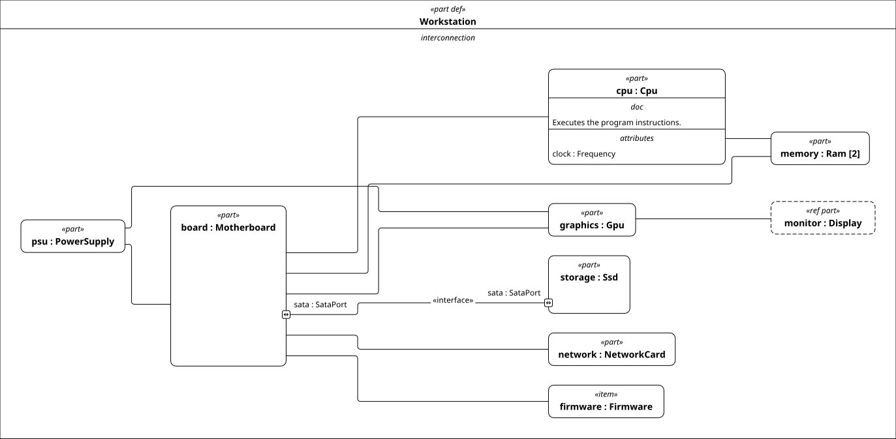

### 2b. View-scoped rendering — `expose` narrows the diagram to two parts

The same model also declares `CoreLinkInterconnectionView`, which exposes only
`Workstation::cpu` and `Workstation::memory`. The root part (`Workstation`) is kept,
but every other part usage — and every connector with an endpoint outside the exposed
scope (to `board`, `graphics`, `storage`, `psu`, `network`) — is dropped, leaving just
the two exposed parts and the connection directly between them (`c8`).

Model: [`models/02-computer-interconnection.sysml`](models/02-computer-interconnection.sysml)
(`CoreLinkInterconnectionView`) ·
SVG: [`svg/CoreLinkInterconnectionView.svg`](svg/CoreLinkInterconnectionView.svg)

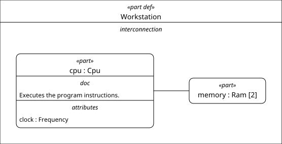

---

## 3. State Transition View — Elevator Controller

Shows states placed top-to-bottom by the layered layout pipeline inside a frame headed
`«state def» ElevatorStates`, an initial pseudo-state, a final pseudo-state, and transitions routed
as orthogonal arrows labeled `trigger [guard] / effect` (each part appears only when the transition
declares it). The initial marker (an open-arrowhead arrow) targets the state named by the explicit
`first start then idle;` transition; a state machine with no explicit initial transition is drawn
without an initial marker. A transition into `done` (`transition first doorsOpen accept shutdown
then done;`) ends in the final badge, a bullseye. `doorsOpening` lists its `entry`, `do`, and `exit`
actions in compartments titled with the keyword, and `doorsClosing` lists an `entry` action. The
`idle`/`doorsClosing` pair uses the attached-transition idiom
(`state idle; accept callReceived if doorsClear do action dimLights then doorsClosing;`) instead
of a standalone `transition` statement, and shows a full `trigger [guard] / effect` label.

The model's `then done;` produces one lint warning, `Unresolved reference: 'done'`: the reference
resolver resolves the inherited `start`/`done` names only as a transition *source*. The diagram is
unaffected. Composite (nested) states are not drawn yet; see the roadmap.

Model: [`models/03-elevator-state.sysml`](models/03-elevator-state.sysml) ·
SVG: [`svg/ElevatorStateTransitionView.svg`](svg/ElevatorStateTransitionView.svg)


---

## 4. Action Flow View — CI/CD Pipeline

Shows actions arranged top-to-bottom by the layered layout pipeline, with a start node, a done
node, a terminate node, and a quality-gate branch and join. The start and done connectors are
dashed open-arrowhead lines like every succession, and they attach where the model says:
`first start then checkout;` enters `checkout` and `then done;` follows `notifySuccess`. The
`build` step, typed by the `BuildStep` action definition, reads `build : BuildStep`. It fans out
through a named `fork` (drawn as a thick bar, without a label) into parallel
`unitTest`/`securityScan` branches that rejoin through a named `join` (also a thick bar) before
`qualityGate`. `awaitApproval` is an accept action and `notifySuccess` a send action: each is a
box with the specification's corner icon and lists its payload (`accept ApprovalSignal`,
`send releaseNote to team`). After `smokeTest` a decision (a diamond) branches on `[smokePassed]`
or `else`; the `else` branch ends in the crossed-circle terminate node `abort`. The `checkout` step
uses the compact `action checkout; then restoreDependencies;` idiom instead of a standalone
`first ... then ...;` succession statement.

The model's `then done;` produces one lint warning, `Unresolved reference: 'done'` (see section 3).

Model: [`models/04-pipeline-action-flow.sysml`](models/04-pipeline-action-flow.sysml) ·
SVG: [`svg/PipelineActionFlowView.svg`](svg/PipelineActionFlowView.svg)

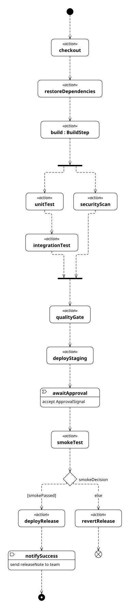

---

## 5. Sequence View — OAuth 2.0 Login

Shows lifelines for each participant and the ordered messages exchanged during an
OAuth authorization-code login; each message ends in a hollow triangle arrowhead.

Model: [`models/05-oauth-sequence.sysml`](models/05-oauth-sequence.sysml) ·
SVG: [`svg/OAuthSequenceView.svg`](svg/OAuthSequenceView.svg)


### 5b. View-scoped rendering — `expose` narrows the diagram to two lifelines

The same model also declares `TokenExchangeSequenceView`, which exposes
`AuthorizationFlow::browser` and `AuthorizationFlow::authServer`. Only those two
lifelines remain, and every message with an endpoint on `user` or `resourceServer`
(`openApp`, `promptCredentials`, `submitCredentials`, `fetchResource`, `resourceData`)
is dropped as dangling, leaving just the token-exchange leg of the flow (`redirect`,
`authCode`, `exchangeCode`, `accessToken`).

Model: [`models/05-oauth-sequence.sysml`](models/05-oauth-sequence.sysml) (`TokenExchangeSequenceView`) ·
SVG: [`svg/TokenExchangeSequenceView.svg`](svg/TokenExchangeSequenceView.svg)

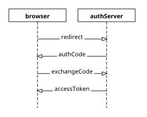

---

## 6. Grid View — Vehicle Taxonomy

Shows a specialization relationship matrix: a cell is marked where the row
definition specializes the column definition.

Model: [`models/06-vehicle-grid.sysml`](models/06-vehicle-grid.sysml) ·
SVG: [`svg/TaxonomyMatrixView.svg`](svg/TaxonomyMatrixView.svg)

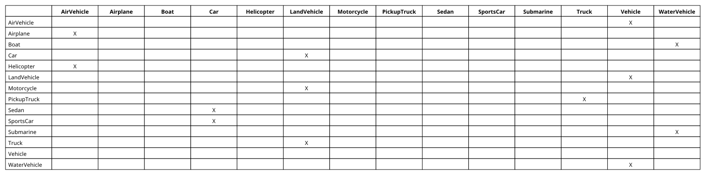

### 6b. View-scoped rendering — `expose` narrows the matrix along specialization

The same model also declares `CarLineageGridView`, which exposes only `Car`. Because
a matrix cell inherently relates two definitions, Grid View keeps a row/column when
either dimension is in scope: `Car` itself, its supertype `LandVehicle`, and its
subtypes `Sedan` and `SportsCar` all remain, while every unrelated definition
(`Vehicle`, `WaterVehicle`, `AirVehicle`, `Truck`, `PickupTruck`, `Motorcycle`,
`Boat`, `Submarine`, `Airplane`, `Helicopter`) is dropped.

Model: [`models/06-vehicle-grid.sysml`](models/06-vehicle-grid.sysml) (`CarLineageGridView`) ·
SVG: [`svg/CarLineageGridView.svg`](svg/CarLineageGridView.svg)

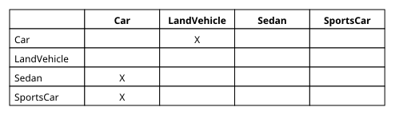

---

## 7. Browser View — Avionics System

Shows the membership hierarchy of nested packages and definitions as an indented
tree with parent-to-child connectors; each row reads `«keyword» Name` (for example
`«part def» Aileron`). The view declares an explicit `render
asTreeDiagram;` statement, so the browser strategy is selected directly rather
than inferred from the view's name.

Model: [`models/07-avionics-browser.sysml`](models/07-avionics-browser.sysml) ·
SVG: [`svg/AvionicsBrowserView.svg`](svg/AvionicsBrowserView.svg)

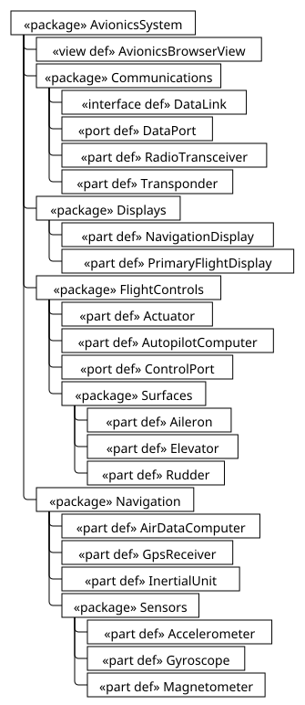

---

## 8. Nested Interconnection View — Computer System

Shows a two-level nested Interconnection View. The `Computer` part contains a `board`
typed by `Motherboard`, which has its own internal `cpu`, `chipset`, and `ram` parts and
connections. The motherboard's interior is laid out recursively (bottom-up) and nested
inside the `board` container box, while the outer power and storage connections route
between the top-level parts. The view declares an explicit `render
asInterconnectionDiagram;` statement, so the interconnection strategy is
selected directly rather than inferred from the view's name.

Model: [`models/08-nested-interconnection.sysml`](models/08-nested-interconnection.sysml) ·
SVG: [`svg/ComputerSystemInterconnectionView.svg`](svg/ComputerSystemInterconnectionView.svg)


---

## 9. Multi-Port Interconnection View — Motor/Controller Rig

Shows multiple independent, named-port connections between the same two parts: a
`motor` is wired to its `controller` by three separate connections (`powerLink`,
`encoderLink`, `thermalLink`), each between its own distinct pair of ports. This
demonstrates that the interconnection layout keeps every parallel connector between
the same two boxes visually and structurally distinct — rather than collapsing them
onto one shared route — and labels each end with its own SysML port name, with the
boxes auto-sized to keep every port label clear of the box's own title.

Model: [`models/09-motor-controller-multi-port.sysml`](models/09-motor-controller-multi-port.sysml) ·
SVG: [`svg/MotorRigInterconnectionView.svg`](svg/MotorRigInterconnectionView.svg)


---

## 10. Expose Recursion Semantics — Mission Control Hierarchy

Shows all four `expose` recursion forms side by side on the same nested-package model
(`GroundSegment` contains a `RadioNetwork` sub-package with `Uplink`/`Downlink`, plus
`OperatorConsole` — itself owning nested `DisplayPanel`/`CommsHandset` definitions — and
a sibling leaf `ThermalRegulator`). See the user guide's
[Expose Recursion Semantics](../user_guide/introduction.md#expose-vs-render-worked-examples)
section for the full grammar/semantics explanation.

`OperatorConsoleExactView` (`expose GroundSegment::OperatorConsole;`, MembershipExact — no
`::**`) exposes only `OperatorConsole` itself; its nested `DisplayPanel`/`CommsHandset`
are excluded.

Model: [`models/10-mission-control-expose-recursion.sysml`](models/10-mission-control-expose-recursion.sysml)
(`OperatorConsoleExactView`) · SVG: [`svg/OperatorConsoleExactView.svg`](svg/OperatorConsoleExactView.svg)


`OperatorConsoleDeepView` (`expose GroundSegment::OperatorConsole::**;`,
MembershipRecursive) exposes `OperatorConsole` and its entire containment subtree:
`DisplayPanel` and `CommsHandset` are now included too.

Model: [`models/10-mission-control-expose-recursion.sysml`](models/10-mission-control-expose-recursion.sysml)
(`OperatorConsoleDeepView`) · SVG: [`svg/OperatorConsoleDeepView.svg`](svg/OperatorConsoleDeepView.svg)

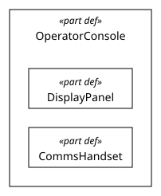

`GroundSegmentDirectChildrenView` (`expose GroundSegment::*;`, NamespaceDirectChildren)
exposes only `GroundSegment`'s direct members, one level deep: `OperatorConsole`, `ThermalRegulator`,
and the `RadioNetwork` package itself (drawn as an empty package node, since its own members
`Uplink`/`Downlink` are two levels below `GroundSegment` and so are not exposed) appear, but neither
`OperatorConsole`'s own nested definitions nor `RadioNetwork`'s contents do — and `GroundSegment`
itself is not included either.

Model: [`models/10-mission-control-expose-recursion.sysml`](models/10-mission-control-expose-recursion.sysml)
(`GroundSegmentDirectChildrenView`) ·
SVG: [`svg/GroundSegmentDirectChildrenView.svg`](svg/GroundSegmentDirectChildrenView.svg)


`GroundSegmentRecursiveView` (`expose GroundSegment::*::**;`, NamespaceRecursive) exposes
every descendant of `GroundSegment`, recursively — `OperatorConsole`, `DisplayPanel`,
`CommsHandset`, `ThermalRegulator`, `Uplink`, and `Downlink` all appear. `RadioNetwork` is
itself a descendant of `GroundSegment`, so it is drawn as a package folder around its members
`Uplink`/`Downlink`. `GroundSegment` (also a bare package) is excluded from scope and shows no
folder.

Model: [`models/10-mission-control-expose-recursion.sysml`](models/10-mission-control-expose-recursion.sysml)
(`GroundSegmentRecursiveView`) · SVG: [`svg/GroundSegmentRecursiveView.svg`](svg/GroundSegmentRecursiveView.svg)

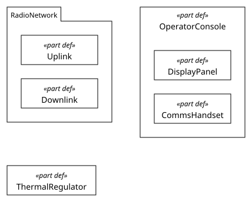

> **Note:** the `GroundSegment` folder from section 10's unscoped `MissionControlGeneralView`
> does **not** appear in any of the four scoped views above (`OperatorConsoleExactView`,
> `OperatorConsoleDeepView`, `GroundSegmentDirectChildrenView`, `GroundSegmentRecursiveView`).
> `GroundSegment` is a bare package — it is never itself admitted content, only an ancestor of
> whatever content each `expose` statement actually names — so once a view is scoped, General
> View no longer wraps that content in a folder for an ancestor the scope never referenced.
> The same fix applies to section 1b above: the `QuadcopterDrone` folder no longer appears
> around `Battery` in `BatterySubsystemView`, since `QuadcopterDrone` itself was never exposed —
> only `Battery` was.

The unscoped `MissionControlGeneralView` in the same model draws the whole hierarchy: the
`MissionControl` folder holds the `GroundSegment` and `SpaceSegment` folders, and
`GroundSegment` in turn holds the `RadioNetwork` folder beside the `OperatorConsole` and
`ThermalRegulator` boxes, because a nested package is drawn inside its owner's folder.

Model: [`models/10-mission-control-expose-recursion.sysml`](models/10-mission-control-expose-recursion.sysml)
(`MissionControlGeneralView`) · SVG: [`svg/MissionControlGeneralView.svg`](svg/MissionControlGeneralView.svg)


---

## 11. General View — Nested Packages and Cross-Package Edges

Shows how a General View draws a package hierarchy. The `Vehicle` package owns two nested
packages, `Powertrain` and `Body`, which are drawn as folders **inside** the `Vehicle` folder
rather than beside it, together with `Car`, a definition owned by `Vehicle` itself.

Every relationship between two drawn definitions is drawn as a connector between the two
definition boxes themselves, whichever packages they are in. `Hybrid :> Powertrain::Engine`
is a specialization that crosses from the `Body` package into the `Powertrain` package, and
`Car`'s `engine : Powertrain::Engine` and `chassis : Body::Chassis` parts draw filled-diamond
composition edges from the nested packages' definitions to the owner-level `Car` box. Each
connector is declared in the innermost container that encloses both of its ends (here the
`Vehicle` folder), so it leaves the nested folders and ends on the definition boxes, not on the
folder borders. Specializations inside one package (`ElectricMotor :> Engine`,
`SportsChassis :> Chassis`) stay inside that package's folder.

The order of the definitions inside a folder follows where their relationships lead rather than the
order they were declared in: `Hybrid` is declared after `Chassis`, but its specialization leads into
the nearer `Powertrain` folder while `Chassis`'s composition leads past it to `Car`, so `Hybrid` is
drawn above `Chassis` and the connectors do not cross.

Model: [`models/11-nested-packages-general.sysml`](models/11-nested-packages-general.sysml) ·
SVG: [`svg/VehiclePackagesGeneralView.svg`](svg/VehiclePackagesGeneralView.svg)

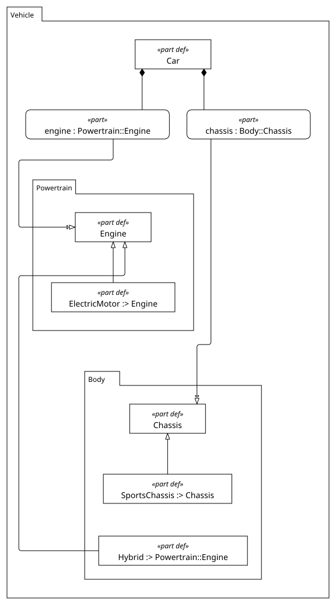

---

## 12. State Transition View — Heater (notation showcase)

A deliberately small state machine that shows the state notation on its own: `standby` lists an
`entry` action, `heating` lists `entry`, `do`, and `exit` actions in compartments titled with the
keyword, `switchOn [tempLow] / beep` is a full `trigger [guard] / effect` label, `cooled` is a back
edge into `standby`, and the machine starts at an initial state and ends in a final state. The
model's `then done;` produces one lint warning (see section 3).

Model: [`models/12-heater-state.sysml`](models/12-heater-state.sysml) ·
SVG: [`svg/HeaterStateView.svg`](svg/HeaterStateView.svg)

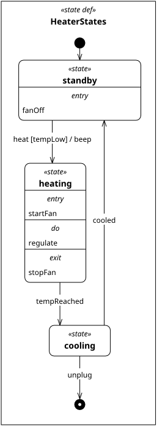

---

## 13. Action Flow View — Order Handling (notation showcase)

A deliberately small action flow that shows the action-flow notation on its own: a start node,
`receive` as an accept action, a decision (a diamond) that branches on `[inStock]` or `else`, a
fork and a join drawn as thick bars, `ship` as a send action, a done node after `ship`, and a
crossed-circle terminate node after `reject`. The model's `then done;` produces one lint warning
(see section 3).

Model: [`models/13-order-action-flow.sysml`](models/13-order-action-flow.sysml) ·
SVG: [`svg/OrderActionFlowView.svg`](svg/OrderActionFlowView.svg)


---

## View coverage

| # | View type | Example system | Status |
| --- | --- | --- | --- |
| 1 | General View | Quadcopter Drone | ✅ |
| 2 | Interconnection View | Desktop Workstation | ✅ |
| 3 | State Transition View | Elevator Controller | ✅ |
| 4 | Action Flow View | CI/CD Pipeline | ✅ |
| 5 | Sequence View | OAuth 2.0 Login | ✅ |
| 6 | Grid View | Vehicle Taxonomy | ✅ |
| 7 | Browser View | Avionics System | ✅ |
| 8 | Nested Interconnection View | Computer System | ✅ |
| 9 | Multi-Port Interconnection View | Motor/Controller Rig | ✅ |
| 10 | Geometry View | — | Deferred (requires spatial coordinate data) |
| 11 | General View — Nested Packages | Vehicle Packages | ✅ |
| 12 | State Transition View — notation showcase | Heater | ✅ |
| 13 | Action Flow View — notation showcase | Order Handling | ✅ |
