# SysML2Tools Diagram Gallery

This gallery showcases every diagram view type that SysML2Tools can render, each
generated from an interesting example system. Every model is rendered to both
**PNG** (raster, in [`png/`](png/)) and **SVG** (vector, in [`svg/`](svg/)).

All diagrams are produced by the `sysml2tools render` command directly from the
SysML v2 textual models in [`models/`](models/) — no manual layout. Where a
model declares an explicit `render asTreeDiagram;` or `render
asInterconnectionDiagram;` statement (the two rendering kinds SysML2Tools
currently implements), that takes precedence; otherwise the view kind is
inferred from each view's name (see the
[DiagramTypeRouter design](../design/sysml2-tools-core/rendering/internal/diagram-type-router.md)
for the full dispatch rules).

Every diagram uses the same plain, spec-style notation: white boxes with black one-pixel
borders and lines (the `SysmlThemes.Plain` theme), with meaning carried by shape, border and
line style, and text rather than by fill color.

To regenerate the gallery, run for each model:

```pwsh
sysml2tools render <model>.sysml --format png --output docs/gallery/png
sysml2tools render <model>.sysml --format svg --output docs/gallery/svg
```

For example, to regenerate every image at once (from the repository root, with the `sysml2tools`
tool installed):

```pwsh
foreach ($model in Get-ChildItem docs/gallery/models/*.sysml) {
    sysml2tools render $model.FullName --format png --output docs/gallery/png
    sysml2tools render $model.FullName --format svg --output docs/gallery/svg
}
```

Regenerate the whole gallery whenever the layout or the drawing code changes, since a change to
either can alter every image, and review each changed PNG before committing it.

---

## 1. General View — Quadcopter Drone

Shows every definition kind (part, port, interface, attribute, enumeration,
requirement) grouped in a package folder (with the package name in the folder's tab),
with typed compartments (attributes, ports) and specialization edges. Definitions are
placed by a layered (ELK-style) engine with orthogonal edge routing; the graph flows
top-to-bottom, so an owner or general definition is drawn above the elements that refer to it.

Each part usage (`airframe`, `controller`, `motors`, and so on) is drawn as its own rounded box
labeled `name : Type`, joined to its owner `Drone` by a filled-diamond composition edge and to
the definition that types it, drawn below it, by a feature-typing edge (a hollow triangle with
two dots at the definition). Definitions that nothing refers to are packed together in a block of
three columns, placed in the free space of the diagram (right of `Battery`, below the sensors) instead
of widening it. See [section 14](#14-general-view--usages-typing-subsetting-and-redefinition) for
the usage notation in a small model of its own.

`RacingMotor` also redefines `Motor`'s inherited `maxThrust` attribute
(`attribute :>> maxThrust : Mass;`). An attribute is a compartment row, so the redefinition
is shown as the row `maxThrust : Mass :>> maxThrust` in the `attributes` compartment and not
as a connector. The hollow-triangle-with-crossbar marker of a redefinition appears when a usage
that is drawn as a node redefines another usage; see
[section 14](#14-general-view--usages-typing-subsetting-and-redefinition) (`mainMotor :>> main`).

`Drone`'s `connect controller.power to battery.output;` statement demonstrates
the plain, unmarked solid line used for `connect` between two sibling parts'
ports. `RacingDrone`'s `part frontMotors : Motor[2] subsets motors;` narrows
`Drone`'s inherited `motors` feature, demonstrating the hollow-triangle
marker used for `subsets`/`:>` feature subsetting. `allocate FlightTimeRequirement
to Battery;` demonstrates the solid open-chevron line carrying the
`«allocate»` stereotype label used for allocation relationships, while the
standalone `dependency FlightController to Battery;` statement demonstrates the
dashed open-chevron line without a label, used for general OMG
dependency relationships.

`Battery`'s `comment /* ... */` annotation demonstrates the `BoxShape.Note`
(folded-corner) box rendered for a commented element, connected to its box by
a dashed line with no arrowhead, and its `doc /* ... */` documentation is drawn as a
word-wrapped `doc` compartment inside the `Battery` box. `FlightMode` is now an
`enum def` with literal values
(`idle`/`manual`/`autonomous`), demonstrating the `enums` compartment.
`FlightTimeRequirement` gains a `subject`/`require constraint` body,
demonstrating the stereotype-titled `«subject»`/`«require constraint»`
compartments (a constraint compartment shows its raw expression text rather
than a `name : Type` row). A definition that specializes another shows the
specialization in its name line (`RacingDrone :> Drone`), and a definition's short name
(`<shortName>`) would be shown ahead of its name.

Model: [`models/01-drone-general.sysml`](models/01-drone-general.sysml) ·
SVG: [`svg/DroneGeneralView.svg`](svg/DroneGeneralView.svg)


### 1b. View-scoped rendering — `expose` narrows the same model to one subsystem

The same `01-drone-general.sysml` model also declares a second, named `view` usage
that adds an `expose Battery::**;` statement. Instead of the full workspace, the diagram
is scoped to the `Battery` definition and its members — with no wrapping `QuadcopterDrone`
folder, since the package `QuadcopterDrone` was never itself exposed — demonstrating that
`expose` (not `render`) is what controls diagram content scope. The view also declares the
view condition `filter not @SysML::Documentation;`, so `Battery`'s documentation is not drawn
while its comment note still is. See the user
guide's [Expose vs. Render](../user_guide/introduction.md#expose-vs-render-worked-examples)
section for the full explanation and more worked examples.

Model: [`models/01-drone-general.sysml`](models/01-drone-general.sysml) (`BatterySubsystemView`) ·
SVG: [`svg/BatterySubsystemView.svg`](svg/BatterySubsystemView.svg)


---

## 2. Interconnection View — Desktop Workstation

Shows the internal structure of a part in the SysML v2 notation: rounded usage boxes headed by
their keyword (`«part»`, `«item»`, and a dashed `«ref part»` for the `monitor` reference usage),
the `doc` and `attributes` compartments of `cpu`, the `memory` multiplicity, the declared `sata`
ports of the motherboard and the SSD (a white square with an `inout` arrow and a `name : Type`
label outside the part), and connectors routed between them, including the `«interface»`
connector between the two ports. The frame carries the italic `interconnection` title.
The motherboard sits at the hub of the component connections. The view declares an
explicit `render asInterconnectionDiagram;` statement, so the interconnection
strategy is selected directly rather than inferred from the view's name.

Model: [`models/02-computer-interconnection.sysml`](models/02-computer-interconnection.sysml) ·
SVG: [`svg/WorkstationInterconnectionView.svg`](svg/WorkstationInterconnectionView.svg)


### 2b. View-scoped rendering — `expose` narrows the diagram to two parts

The same model also declares `CoreLinkInterconnectionView`, which exposes only
`Workstation::cpu` and `Workstation::memory`. The root part (`Workstation`) is kept,
but every other usage — and every connector with an endpoint outside the exposed
scope (to `board`, `graphics`, `storage`, `psu`, `network`) — is dropped, leaving just
the two exposed parts and the connection directly between them (`c8`).

Model: [`models/02-computer-interconnection.sysml`](models/02-computer-interconnection.sysml)
(`CoreLinkInterconnectionView`) ·
SVG: [`svg/CoreLinkInterconnectionView.svg`](svg/CoreLinkInterconnectionView.svg)


---

## 3. State Transition View — Elevator Controller

Shows states placed top-to-bottom by the layered layout pipeline inside a frame headed
`«state def» ElevatorStates`, an initial pseudo-state, a final pseudo-state, and transitions routed
as orthogonal arrows labeled `trigger [guard] / effect` (each part appears only when the transition
declares it). The initial marker (an open-arrowhead arrow) targets the state named by the explicit
`first start then idle;` transition; a state machine with no explicit initial transition is drawn
without an initial marker. A transition into `done` (`transition first doorsOpen accept shutdown
then done;`) ends in the final badge, a bullseye. `doorsOpening` lists its `entry`, `do`, and `exit`
actions in compartments titled with the keyword, and `doorsClosing` lists an `entry` action. The
`idle`/`doorsClosing` pair uses the attached-transition idiom
(`state idle; accept callReceived if doorsClear do action dimLights then doorsClosing;`) instead
of a standalone `transition` statement, and shows a full `trigger [guard] / effect` label. The
`doorsOpen` → `doorsClosing` transition is a plain `accept timeout` trigger, drawn as a back edge
that ends in a flush open chevron.

The model's `then done;` produces one lint warning, `Unresolved reference: 'done'`: the reference
resolver resolves the inherited `start`/`done` names only as a transition *source*. The diagram is
unaffected. Composite (nested) states are not drawn yet; see the roadmap.

Model: [`models/03-elevator-state.sysml`](models/03-elevator-state.sysml) ·
SVG: [`svg/ElevatorStateTransitionView.svg`](svg/ElevatorStateTransitionView.svg)

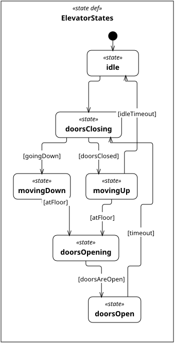

---

## 4. Action Flow View — CI/CD Pipeline

Shows actions arranged top-to-bottom by the layered layout pipeline, with a start node, a done
node, a terminate node, and a quality-gate branch and join. The start and done connectors are
dashed open-arrowhead lines like every succession, and they attach where the model says:
`first start then checkout;` enters `checkout` and `then done;` follows `notifySuccess`. The
`build` step, typed by the `BuildStep` action definition, reads `build : BuildStep`. It fans out
through a named `fork` (drawn as a thick bar, without a label) into parallel
`unitTest`/`securityScan` branches that rejoin through a named `join` (also a thick bar) before
`qualityGate`. `awaitApproval` is an accept action and `notifySuccess` a send action: each is a
box with the specification's corner icon and lists its payload (`accept ApprovalSignal`,
`send releaseNote to team`). After `smokeTest` a decision (a diamond) branches on `[smokePassed]`
or `else`; the `else` branch ends in the crossed-circle terminate node `abort`. The `checkout` step
uses the compact `action checkout; then restoreDependencies;` idiom instead of a standalone
`first ... then ...;` succession statement.

The model's `then done;` produces one lint warning, `Unresolved reference: 'done'` (see section 3).

Model: [`models/04-pipeline-action-flow.sysml`](models/04-pipeline-action-flow.sysml) ·
SVG: [`svg/PipelineActionFlowView.svg`](svg/PipelineActionFlowView.svg)


---

## 5. Sequence View — OAuth 2.0 Login

Shows the interaction of an OAuth authorization-code login in the SysML v2 notation: every declared
part is a lifeline under a rounded header with the `«part»` keyword over `name : Type` (the resource
server is a reference part, so its header is dashed, and the audit log is declared but exchanges no
message, so it still has a lifeline). Each message ends in a hollow triangle arrowhead and is labeled
`name of Payload` when it carries one. The messages are drawn in the order of the events they connect:
`accessToken` is declared before `exchangeCode` in the model but is drawn after it.

Model: [`models/05-oauth-sequence.sysml`](models/05-oauth-sequence.sysml) ·
SVG: [`svg/OAuthSequenceView.svg`](svg/OAuthSequenceView.svg)

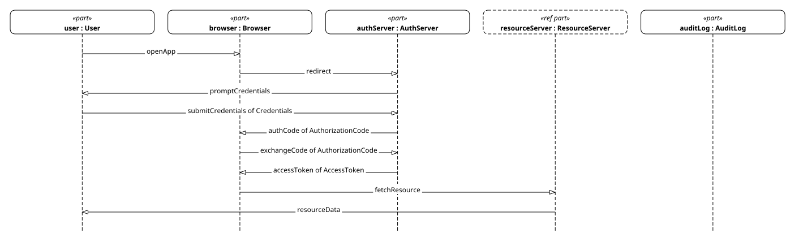

### 5b. View-scoped rendering — `expose` narrows the diagram to two lifelines

The same model also declares `TokenExchangeSequenceView`, which exposes
`AuthorizationFlow::browser` and `AuthorizationFlow::authServer`. Only those two
lifelines remain, and every message with an endpoint on `user` or `resourceServer`
(`openApp`, `promptCredentials`, `submitCredentials`, `fetchResource`, `resourceData`)
is dropped as dangling, leaving just the token-exchange leg of the flow (`redirect`,
`authCode`, `exchangeCode`, `accessToken`).

Model: [`models/05-oauth-sequence.sysml`](models/05-oauth-sequence.sysml) (`TokenExchangeSequenceView`) ·
SVG: [`svg/TokenExchangeSequenceView.svg`](svg/TokenExchangeSequenceView.svg)


---

## 6. Grid View — Vehicle Taxonomy

Shows a specialization relationship matrix: a cell is marked where the row
definition specializes the column definition.

Model: [`models/06-vehicle-grid.sysml`](models/06-vehicle-grid.sysml) ·
SVG: [`svg/TaxonomyMatrixView.svg`](svg/TaxonomyMatrixView.svg)


### 6b. View-scoped rendering — `expose` narrows the matrix along specialization

The same model also declares `CarLineageGridView`, which exposes only `Car`. Because
a matrix cell inherently relates two definitions, Grid View keeps a row/column when
either dimension is in scope: `Car` itself, its supertype `LandVehicle`, and its
subtypes `Sedan` and `SportsCar` all remain, while every unrelated definition
(`Vehicle`, `WaterVehicle`, `AirVehicle`, `Truck`, `PickupTruck`, `Motorcycle`,
`Boat`, `Submarine`, `Airplane`, `Helicopter`) is dropped.

Model: [`models/06-vehicle-grid.sysml`](models/06-vehicle-grid.sysml) (`CarLineageGridView`) ·
SVG: [`svg/CarLineageGridView.svg`](svg/CarLineageGridView.svg)


---

## 7. Browser View — Avionics System

Shows the membership hierarchy of nested packages and definitions as an indented
tree with parent-to-child connectors; each row reads `«keyword» Name` (for example
`«part def» Aileron`). The view declares an explicit `render
asTreeDiagram;` statement, so the browser strategy is selected directly rather
than inferred from the view's name.

Model: [`models/07-avionics-browser.sysml`](models/07-avionics-browser.sysml) ·
SVG: [`svg/AvionicsBrowserView.svg`](svg/AvionicsBrowserView.svg)


---

## 8. Nested Interconnection View — Computer System

Shows a two-level nested Interconnection View. The `Computer` part contains a `board`
typed by `Motherboard`, which has its own internal `cpu`, `chipset`, and `ram` parts and
connections. The motherboard's interior is laid out recursively (bottom-up) and nested
inside the `board` container box, while the outer power and storage connections route
between the declared ports of the top-level parts. The `Computer` frame draws its own `mains`
and `video` ports on its border (connectors to a frame port are not drawn), and the
motherboard's ports are drawn on the `board` box. The view declares an explicit `render
asInterconnectionDiagram;` statement, so the interconnection strategy is
selected directly rather than inferred from the view's name.

Model: [`models/08-nested-interconnection.sysml`](models/08-nested-interconnection.sysml) ·
SVG: [`svg/ComputerSystemInterconnectionView.svg`](svg/ComputerSystemInterconnectionView.svg)

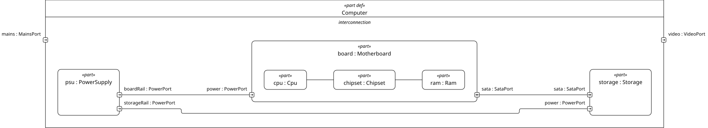

---

## 9. Multi-Port Interconnection View — Motor/Controller Rig

Shows multiple independent, named-port connections between the same parts, with one connector
of every kind: `powerLink` is a connection whose ends declare a role name and a multiplicity
(`supply` and `drive`, `[1]`), `encoderLink` a plain connection, `thermalLink` a binding
(labeled `=`), an anonymous flow (filled arrowhead, labeled with its payload), and an
anonymous interface (labeled `«interface»`). The ports follow the SysML v2 notation: an arrow
for `in`, `out`, and `inout`, a dashed square for the reference port `mount`, the conjugated
label `~PowerPort`, and the `status` port of the controller, which is declared but not
connected to anything and so is placed on the controller's border by the layout. The
interconnection layout keeps every parallel
connector between the same two boxes visually and structurally distinct — rather than
collapsing them onto one shared route — and the boxes are auto-sized to keep every port
label clear of the box's own title.

Model: [`models/09-motor-controller-multi-port.sysml`](models/09-motor-controller-multi-port.sysml) ·
SVG: [`svg/MotorRigInterconnectionView.svg`](svg/MotorRigInterconnectionView.svg)

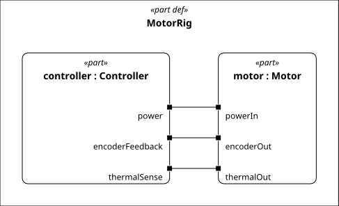

---

## 10. Expose Recursion Semantics — Mission Control Hierarchy

Shows all four `expose` recursion forms side by side on the same nested-package model
(`GroundSegment` contains a `RadioNetwork` sub-package with `Uplink`/`Downlink`, plus
`OperatorConsole` — itself owning nested `DisplayPanel`/`CommsHandset` definitions — and
a sibling leaf `ThermalRegulator`). See the user guide's
[Expose Recursion Semantics](../user_guide/introduction.md#expose-vs-render-worked-examples)
section for the full grammar/semantics explanation.

`OperatorConsoleExactView` (`expose GroundSegment::OperatorConsole;`, MembershipExact — no
`::**`) exposes only `OperatorConsole` itself; its nested `DisplayPanel`/`CommsHandset`
are excluded.

Model: [`models/10-mission-control-expose-recursion.sysml`](models/10-mission-control-expose-recursion.sysml)
(`OperatorConsoleExactView`) · SVG: [`svg/OperatorConsoleExactView.svg`](svg/OperatorConsoleExactView.svg)

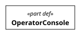

`OperatorConsoleDeepView` (`expose GroundSegment::OperatorConsole::**;`,
MembershipRecursive) exposes `OperatorConsole` and its entire containment subtree:
`DisplayPanel` and `CommsHandset` are now included too.

Model: [`models/10-mission-control-expose-recursion.sysml`](models/10-mission-control-expose-recursion.sysml)
(`OperatorConsoleDeepView`) · SVG: [`svg/OperatorConsoleDeepView.svg`](svg/OperatorConsoleDeepView.svg)


`GroundSegmentDirectChildrenView` (`expose GroundSegment::*;`, NamespaceDirectChildren)
exposes only `GroundSegment`'s direct members, one level deep: `OperatorConsole`, `ThermalRegulator`,
and the `RadioNetwork` package itself (drawn as an empty package node, since its own members
`Uplink`/`Downlink` are two levels below `GroundSegment` and so are not exposed) appear, but neither
`OperatorConsole`'s own nested definitions nor `RadioNetwork`'s contents do — and `GroundSegment`
itself is not included either.

Model: [`models/10-mission-control-expose-recursion.sysml`](models/10-mission-control-expose-recursion.sysml)
(`GroundSegmentDirectChildrenView`) ·
SVG: [`svg/GroundSegmentDirectChildrenView.svg`](svg/GroundSegmentDirectChildrenView.svg)

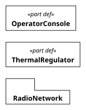

`GroundSegmentRecursiveView` (`expose GroundSegment::*::**;`, NamespaceRecursive) exposes
every descendant of `GroundSegment`, recursively — `OperatorConsole`, `DisplayPanel`,
`CommsHandset`, `ThermalRegulator`, `Uplink`, and `Downlink` all appear. `RadioNetwork` is
itself a descendant of `GroundSegment`, so it is drawn as a package folder around its members
`Uplink`/`Downlink`. `GroundSegment` (also a bare package) is excluded from scope and shows no
folder.

Model: [`models/10-mission-control-expose-recursion.sysml`](models/10-mission-control-expose-recursion.sysml)
(`GroundSegmentRecursiveView`) · SVG: [`svg/GroundSegmentRecursiveView.svg`](svg/GroundSegmentRecursiveView.svg)


> **Note:** the `GroundSegment` folder from section 10's unscoped `MissionControlGeneralView`
> does **not** appear in any of the four scoped views above (`OperatorConsoleExactView`,
> `OperatorConsoleDeepView`, `GroundSegmentDirectChildrenView`, `GroundSegmentRecursiveView`).
> `GroundSegment` is a bare package — it is never itself admitted content, only an ancestor of
> whatever content each `expose` statement actually names — so once a view is scoped, General
> View no longer wraps that content in a folder for an ancestor the scope never referenced.
> The same fix applies to section 1b above: the `QuadcopterDrone` folder no longer appears
> around `Battery` in `BatterySubsystemView`, since `QuadcopterDrone` itself was never exposed —
> only `Battery` was.

The unscoped `MissionControlGeneralView` in the same model draws the whole hierarchy: the
`MissionControl` folder holds the `GroundSegment` and `SpaceSegment` folders, and
`GroundSegment` in turn holds the `RadioNetwork` folder together with the `OperatorConsole` and
`ThermalRegulator` boxes, because a nested package is drawn inside its owner's folder. Each
folder shows its name in its tab.

Model: [`models/10-mission-control-expose-recursion.sysml`](models/10-mission-control-expose-recursion.sysml)
(`MissionControlGeneralView`) · SVG: [`svg/MissionControlGeneralView.svg`](svg/MissionControlGeneralView.svg)

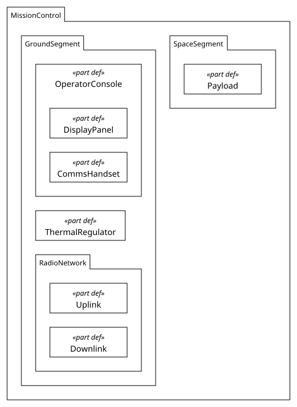

---

## 11. General View — Nested Packages and Cross-Package Edges

Shows how a General View draws a package hierarchy. The `Vehicle` package owns two nested
packages, `Powertrain` and `Body`, which are drawn as folders **inside** the `Vehicle` folder
rather than beside it, together with `Car`, a definition owned by `Vehicle` itself.

Every relationship between two drawn definitions is drawn as a connector between the two
boxes themselves, whichever packages they are in. `Hybrid :> Powertrain::Engine` is a
specialization that crosses from the `Body` package into the `Powertrain` package, and `Car`'s
`engine : Powertrain::Engine` and `chassis : Body::Chassis` part usages are drawn as rounded
boxes joined to `Car` by filled-diamond composition edges and to the definitions that type them,
inside the nested folders, by feature-typing edges. Each connector is declared in the innermost
container that encloses both of its ends (here the `Vehicle` folder), so it leaves the nested
folders and ends on the definition boxes, not on the folder borders. Specializations inside one
package (`ElectricMotor :> Engine`, `SportsChassis :> Chassis`) stay inside that package's folder.

The diagram flows top-to-bottom: `Car` and its usages on top, the definitions below. The
`Hybrid` specialization starts in the `Body` folder and points up to `Engine`, so the `Powertrain`
folder is drawn above the `Body` folder. Its connector crosses the `ElectricMotor` to `Engine`
line once (an engine routing outcome). [Section 16](#16-general-view--nested-packages-and-feature-typing)
shows the same package structure without `Hybrid`, side by side.

Model: [`models/11-nested-packages-general.sysml`](models/11-nested-packages-general.sysml) ·
SVG: [`svg/VehiclePackagesGeneralView.svg`](svg/VehiclePackagesGeneralView.svg)


---

## 12. State Transition View — Heater (notation showcase)

A deliberately small state machine that shows the state notation on its own: `standby` lists an
`entry` action, `heating` lists `entry`, `do`, and `exit` actions in compartments titled with the
keyword, `heat [tempLow] / beep` is a full `trigger [guard] / effect` label, `cooled` is a back
edge into `standby`, and the machine starts at an initial state and ends in a final state. The
model's `then done;` produces one lint warning (see section 3).

Model: [`models/12-heater-state.sysml`](models/12-heater-state.sysml) ·
SVG: [`svg/HeaterStateView.svg`](svg/HeaterStateView.svg)


---

## 13. Action Flow View — Order Handling (notation showcase)

A deliberately small action flow that shows the action-flow notation on its own: a start node,
`receive` as an accept action, a decision (a diamond) that branches on `[inStock]` or `else`, a
fork and a join drawn as thick bars, `ship` as a send action, a done node after `ship`, and a
crossed-circle terminate node after `reject`. The model's `then done;` produces one lint warning
(see section 3).

Model: [`models/13-order-action-flow.sysml`](models/13-order-action-flow.sysml) ·
SVG: [`svg/OrderActionFlowView.svg`](svg/OrderActionFlowView.svg)

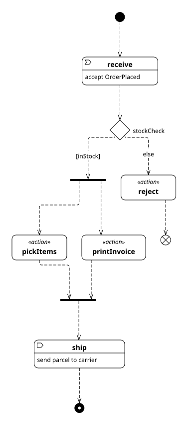

---

## 14. General View — Usages, Typing, Subsetting and Redefinition

A small model (`DriveSystem`) that shows how a General View draws **usages** as nodes and
every relationship a usage can have:

- `DriveUnit` owns three usages. Each part usage is a rounded box labeled `name : Type`
  (`motors : Motor [2]` shows a multiplicity) joined to its owner by a filled-diamond
  composition edge and to its type by a feature-typing edge (hollow triangle with two dots at
  the definition).
- `spare` is a reference usage (`ref part spare : InductionMotor;`): a dashed rounded box with
  the `«ref part»` keyword, joined to its owner by a hollow diamond instead of a filled one.
- `Motor` is an abstract definition: its keyword line reads `«abstract part def»`
  and its name is italic. `InductionMotor :> Motor` is an ordinary definition
  specialization (solid line, hollow triangle at the general definition).
- `RearDrive :> DriveUnit` narrows two inherited usages. `frontMotor :> motors` is subsetting
  (hollow triangle at the subsetted usage) and `mainMotor :>> main` is redefinition (hollow
  triangle with a crossbar at the redefined usage). Neither repeats a type, so each inherits
  the type of the usage it narrows.
- `main` owns a `doc` and a `comment`: the documentation is a `doc` compartment inside the
  box and the comment is a note attached by a dashed line.

Model: [`models/14-usages-typing-general.sysml`](models/14-usages-typing-general.sysml) ·
SVG: [`svg/DriveUnitGeneralView.svg`](svg/DriveUnitGeneralView.svg)

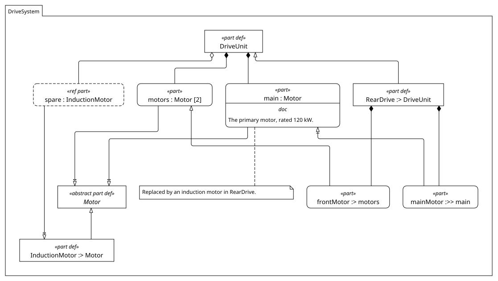

---

## 15. General View — Documentation and Comments on Nested Parts

A minimal model (`ChargingStation`) that isolates how a General View draws annotations owned
by a nested part usage. `Charger` owns the part usages `cable : Cable` and `plug : Plug`.
Documentation owned by a usage is drawn as a `doc` compartment inside that usage's box (both
`cable` and `plug`). A comment owned by a usage is drawn as a separate folded-corner note,
attached to the usage's box by a dashed line with no arrowhead (the note below `cable`).

Model: [`models/15-doc-comment-general.sysml`](models/15-doc-comment-general.sysml) ·
SVG: [`svg/ChargerGeneralView.svg`](svg/ChargerGeneralView.svg)

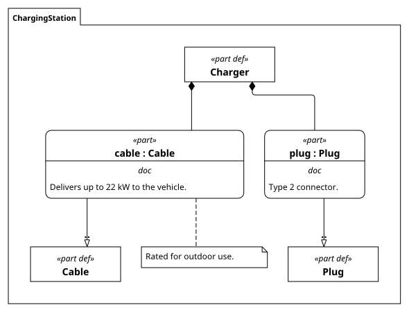

---

## 16. General View — Nested Packages and Feature Typing

The `Vehicle` package of section 11 without the cross-package specialization, which keeps the
diagram small: `Powertrain` and `Body` are folders inside the `Vehicle` folder, each showing its
name in its tab because it holds content. `Car`'s `engine` and `chassis` part usages are drawn
below `Car`, joined to it by filled-diamond composition edges, and each is joined to the
definition that types it inside a nested folder by a feature-typing edge.

Model: [`models/16-nested-packages-typing-general.sysml`](models/16-nested-packages-typing-general.sysml) ·
SVG: [`svg/VehicleTypingGeneralView.svg`](svg/VehicleTypingGeneralView.svg)

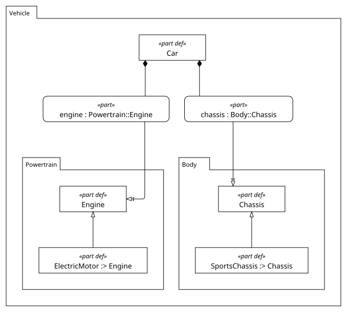

---

## Known deviation: the diagram-quality fill criterion (B5)

The gallery images are checked against the project's diagram-quality criteria. Every image passes
them except one criterion on six images: B5 (state boxes and action boxes fill at
least 20 % of the canvas). The Pipeline image fills 14.2 % (382 × 1780 px) and the Order image fills
11.5 % (377 × 850 px). The Pipeline image already fell short of B5 on `main` (15.2 %). The cause is
the layered layout engine, which keeps a fixed 70 px corridor between consecutive layers (an engine
constant, not an option), so a single-column flow of 8 to 9 layers is mostly corridor. Making such a
flow wider to raise the fill makes it worse, because the canvas grows faster than the boxes do, and
reaching 20 % would need a canvas about 40 % smaller. The deviation is accepted for these two tall,
single-column flows; the State Transition images (Elevator 21.6 %, Heater 25.1 %) pass. Both moved
slightly with the straighter edge routing of rendering engine 0.3.0-beta.4 (the Elevator boxes
are narrower; the Heater canvas is 257 px wide instead of 215 px).

Two Interconnection images also fall short of B5 since the port notation was added: the Workstation
image fills 15.5 % (1373 × 672 px; 19.0 % on `main`) and the Motor Rig image 18.3 % (1411 × 424 px;
46.0 % on `main`). The cause is again the layered layout engine: it reserves, between two columns of
boxes, the width of every outside port label and end label along the connector run (the label of
the port at each end plus the role names), so a connector between labeled ports needs a corridor
several times the fixed 70 px, and the canvas grows faster than the boxes. The Computer System image
(21.5 %) and the Core Link image (29.8 %) pass. The deviation is accepted: the labels are the
point of the notation, and shortening port names or boxes to raise the fill would only tune the
example to the criterion.

The two Sequence images also fall short of B5 (the OAuth image fills 8.9 % and the Token Exchange image
14.6 %, counting the lifeline headers as the blocks; both were lower on `main`, 5.2 % and 8.5 %). A
sequence diagram is mostly lifeline stems and messages, which the criterion does not count, so the
deviation is accepted and the headers are not enlarged to raise the fill. A message label that is
centered on a lifeline it crosses (`fetchResource` and `promptCredentials`) was already so on `main`: the
engine places a message label at the midpoint of its line and does not treat a lifeline stem as an obstacle.

---

## Model changes

`05-oauth-sequence.sysml` was extended to exercise the notation of the Sequence View: added the part
definitions `User`, `Browser`, `AuthServer`, `ResourceServer`, and `AuditLog` and the item definitions
`Credentials`, `AuthorizationCode`, and `AccessToken`; the lifelines are typed (`part user : User`,
and so on); `resourceServer` is a `ref part`; added a `part auditLog : AuditLog` that exchanges no
message; `submitCredentials`, `authCode`, `exchangeCode`, and `accessToken` carry a payload
(`of Credentials`, and so on); and `accessToken` is declared before `exchangeCode` so the diagram shows
the ordering by events. `TokenExchangeSequenceView` is unchanged.

The interconnection models were extended to exercise the notation of the Interconnection View:

- `02-computer-interconnection.sysml`: added `port def SataPort`, `attribute def Frequency`,
  `item def Firmware`, and `part def Display`; the motherboard and the SSD declare an
  `inout port sata`; the `cpu` usage has a `doc` and a `clock` attribute; `memory` is a
  two-element part; added a `ref part monitor`, an `item firmware`, and the connections `c9`
  (graphics to monitor) and `c10` (board to firmware); the former `c4` (board to storage) is now
  an anonymous `interface` between the two `sata` ports. The `CoreLinkInterconnectionView` is
  unchanged.
- `08-nested-interconnection.sysml`: added the port definitions `PowerPort`, `SataPort`,
  `MainsPort`, and `VideoPort`; the power supply, motherboard, and storage declare ports; the
  `Computer` frame declares `mains` and `video`; the connections now join declared ports.
- `09-motor-controller-multi-port.sysml`: every port declares a direction; added `StatusPort`,
  `ShaftPort`, `MountPort`, and `Torque`; the controller has an unconnected `status` port; the motor
  has a conjugated `powerIn : ~PowerPort`, a `shaft`, and a reference port `mount`; added a `Load`
  part; the power link declares role names and multiplicities; `thermalLink` is a binding, and
  the model adds an anonymous flow and an anonymous interface.

---

## View coverage

| # | View type | Example system | Status |
| --- | --- | --- | --- |
| 1 | General View | Quadcopter Drone | ✅ |
| 2 | Interconnection View | Desktop Workstation | ✅ |
| 3 | State Transition View | Elevator Controller | ✅ |
| 4 | Action Flow View | CI/CD Pipeline | ✅ |
| 5 | Sequence View | OAuth 2.0 Login | ✅ |
| 6 | Grid View | Vehicle Taxonomy | ✅ |
| 7 | Browser View | Avionics System | ✅ |
| 8 | Nested Interconnection View | Computer System | ✅ |
| 9 | Multi-Port Interconnection View | Motor/Controller Rig | ✅ |
| 10 | Geometry View | — | Deferred (requires spatial coordinate data) |
| 11 | General View — Nested Packages | Vehicle Packages | ✅ |
| 12 | State Transition View — notation showcase | Heater | ✅ |
| 13 | Action Flow View — notation showcase | Order Handling | ✅ |
| 14 | General View — Usages, Typing, Subsetting, Redefinition | Drive Unit | ✅ |
| 15 | General View — Documentation and Comments on Nested Parts | Charging Station | ✅ |
| 16 | General View — Nested Packages and Feature Typing | Vehicle Typing | ✅ |
